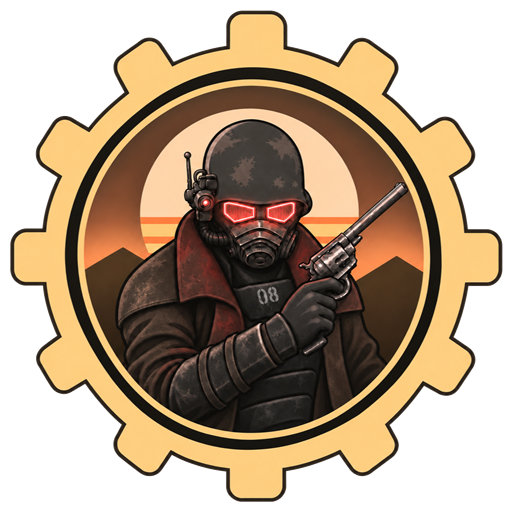
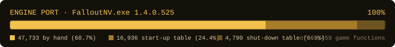

  

<h1 align="center">nv-rs</h1>

**Fallout: New Vegas, rebuilt in Rust, aiming to play exactly like the
original.**

nv-rs is a new engine for Fallout: New Vegas, written in Rust. It runs the
game from your own copy's files. The goal: the game looks and plays exactly
like the original, while everything underneath becomes a modern 64-bit
engine: no 4 GB memory limit, every CPU core in use, high frame rates, fast
loading, far fewer crashes, built-in modding and more platforms.

> [!IMPORTANT]
> nv-rs is an independent project, not affiliated with or endorsed by
> Bethesda Softworks, ZeniMax Media, Obsidian Entertainment or Microsoft. It
> contains no game files; you need your own legally obtained copy of the game.
> See [LEGAL.md](LEGAL.md).

---

## Play the preview

**[Download the Windows preview](https://github.com/slaterain/nv-rs/releases)**: you need
Fallout: New Vegas (version 1.4.0.525; only the Steam version has been tested so far) installed on a Windows PC.

1. Extract the ZIP to a folder of its own, for example `C:\Games\nv-rs`.
2. Double-click `Play.exe`. It finds your game and starts it.
3. `Import my saves.cmd` brings your saves over; `Settings.cmd` has the display options and the
   game fixes.

It never changes your game, your saves or your settings: everything it writes stays in its own
folder. Windows may warn because the program isn't signed. It's a preview: so far it has only been
run on one PC, so please report how it runs on yours (press F12 in the game to make a report).
Keyboard and mouse only for now, and mods that need script-extender plugins (xNVSE, JIP) don't work
yet. The download page lists what works and the known issues.

## Where it stands

**Playable.** The whole game runs on its own translated code: the opening, the open world,
quests, dialogue, combat, V.A.T.S., the Pip-Boy, saves, mods and the DLCs, with the original
graphics and sound. Bugs remain, and it's slower than the original in busy places for now.

**Next:** moving the game's systems to native 64-bit Rust, one family at a time. That's what
lifts the 4 GB memory limit, puts every CPU core to work and brings the speed. After it: new
graphics on wgpu, a built-in script extender, more platforms, co-op and VR.

## Progress

  

The bar counts how much of the original game's code is translated. That part is done; the table
shows what's left.

| | System | Status |
| :---: | --- | --- |
| ✅ | **The whole game:** movement, physics, animation, graphics, sound, combat, AI, quests, dialogue, menus, saves, the open world and the DLCs | Translated, checked against the original and playable |
| ✅ | **Fixes:** bug fixes on by default, the original's behaviour one setting away | First fixes in: frame rate, physics, scripts, no shader-compile stutter on first use, and shorter waits for loading at cell borders; each one can be set in the game's own `Fallout.ini` |
| ✅ | **Windows preview** | [Released](https://github.com/slaterain/nv-rs/releases) |
| 🔨 | **Native 64-bit code:** speed, no memory limit, every core in use | Started; the game's threads run on their own cores and signal each other without one shared lock, its drawing on a thread of its own, its compressed archives unpack in native code, and the first native families are on |
| 🔨 | **Built-in script extender:** xNVSE's and JIP LN's script commands, with nothing to install | Started: xNVSE's variables, loops, functions, events, co-save, inventory references, string and array commands, keyboard and mouse input and most of its inventory commands are in (355 of 654), format strings made exactly as the C runtime makes them; JIP LN's to come |
| 🔨 | **Modern graphics (wgpu)** | Started: the game's own shaders and frames draw on wgpu beside Direct3D 9 for comparison (the main menu identical), and it can run the game on its own for testing; not yet for play |
| ⬜ | **More platforms, co-op, VR** | Planned; texture loading already needs no Windows DLL (D3DX's, translated byte for byte) |

✅ means working, not free of bugs. The details are in [docs/SYSTEMS.md](docs/SYSTEMS.md) and
[docs/MILESTONES.md](docs/MILESTONES.md).

## Why it's different

- **Translated from the original, not guessed.** The original game's program is translated into
  Rust piece by piece, and every piece is checked against the original.
- **Your game, your files.** nv-rs reads the game's own data from your installation and never
  changes it.
- **Modern underneath.** The original's look and play are the reference; the internals are being
  rebuilt in 64-bit Rust, whose memory and thread safety rule out whole classes of crashes.
- **Better where it doesn't change the game.** Fixes and upgrades are switchable; the original
  stays available.
- **Mods keep working.** Regular `.esp` and `.esm` mods load the way they do in the original.

---

## How it's made

To be upfront: nv-rs is built almost entirely with AI coding agents (mainly Claude). The
maintainer directs the project: the plan, the priorities, playtesting and what gets merged.

What keeps it honest is the method: agents don't get to invent behaviour. Every piece of logic is
translated from the original game's program, marked with where it came from, and checked by
tests, by running it against the original's own code and by recordings of the original game.
Everything is in the open, so judge it by how it plays.

## Get involved

- **Play and report:** try the preview and [open an issue](https://github.com/slaterain/nv-rs/issues)
  for anything that differs from the original.
- **Contribute:** read [CONTRIBUTING.md](CONTRIBUTING.md) (and give [AGENTS.md](AGENTS.md) to your
  agent), say in an issue what you'd like to work on, then open a small pull request.
- **Chat** on the project's [Discord](https://discord.gg/pn5kjZJJxx).
- **Support** the project on [Ko-fi](https://ko-fi.com/slater41n). It goes to the AI time the work
  runs on, which is what limits how fast the project moves. It's a voluntary gift: it buys
  nothing and promises no release date, and you still need your own copy of the game.
- **Build from source:** see [docs/PLAYTESTING.md](docs/PLAYTESTING.md). For how it works, start
  with [docs/ENGINE_PORT_PLAN.md](docs/ENGINE_PORT_PLAN.md); every document is linked from
  [docs/README.md](docs/README.md).

Final decisions rest with the maintainer, **slaterain** ([docs/GOVERNANCE.md](docs/GOVERNANCE.md)).

## Legal and license

Original code is licensed under the [GNU GPL v3 or later](LICENSE). The licence covers only
original work. Fallout and Fallout: New Vegas are trademarks of their respective owners. Read
[LEGAL.md](LEGAL.md) for the full notice.
