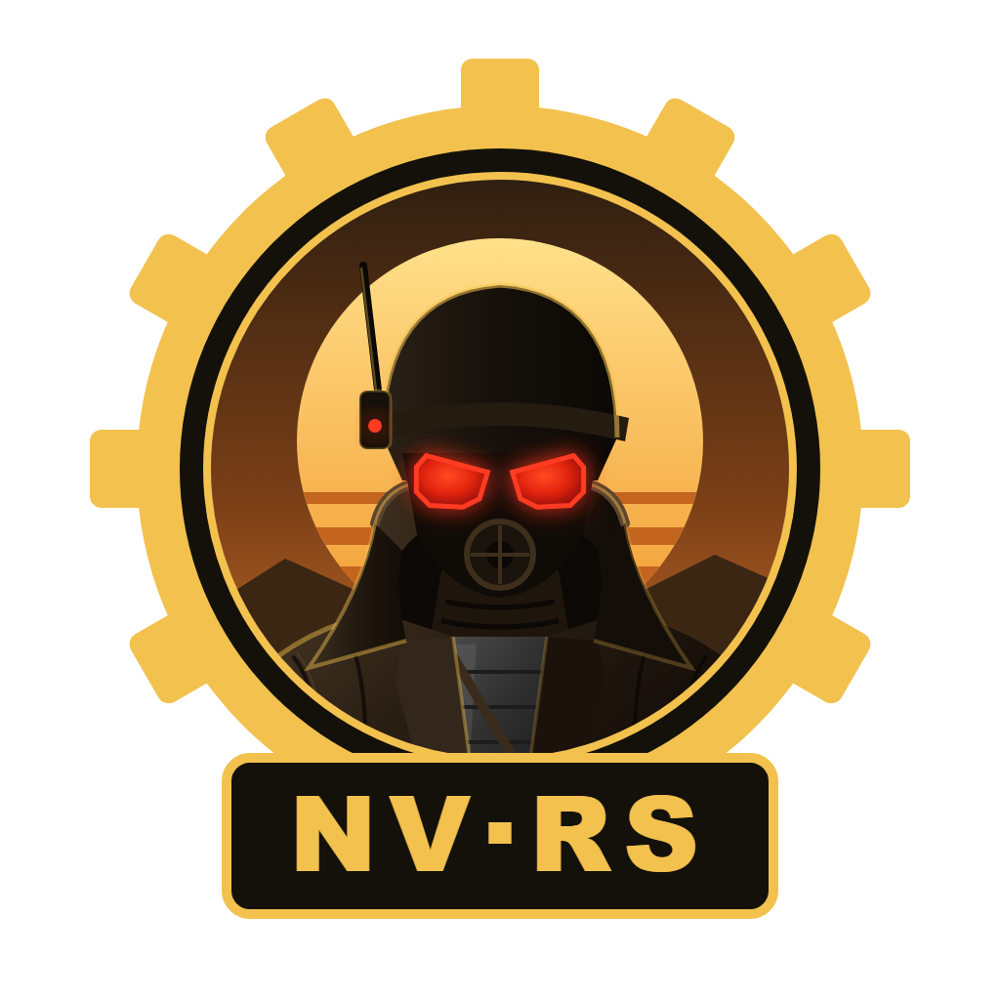

<p align="center">
  
</p>

<h1 align="center">nv-rs</h1>

[](https://www.rust-lang.org/)
[](docs/ENGINE_PORT_PLAN.md)
[](LICENSE)
[](docs/PLAYTESTING.md)
[](docs/MILESTONES.md)
[](https://discord.gg/pn5kjZJJxx)

**Fallout: New Vegas, rebuilt in Rust, aiming to play exactly like the
original.**

nv-rs is a new engine for Fallout: New Vegas, written in Rust. It runs the
game from your own copy's files. The goal: the game looks and plays exactly
like the original, while everything you don't see or feel is rebuilt as a
modern 64-bit engine: no 4 GB memory limit, every CPU core in use, 200+ fps,
fast loading, far fewer crashes, built-in modding and more platforms.

> [!IMPORTANT]
> nv-rs is an independent project, not affiliated with or endorsed by
> Bethesda Softworks, ZeniMax Media, Obsidian Entertainment or Microsoft. It
> contains no game files; you need your own legally obtained copy of the game.
> See [LEGAL.md](LEGAL.md).

---

## Why it's different

- **Translated from the original, not guessed.** The original game's program
  is translated into Rust piece by piece, and every piece is checked against
  the original. Nothing is tuned by eye.
- **Your game, your files.** nv-rs reads the game's own plugins, meshes,
  textures, sounds and menus from your installation and never changes them.
- **Modern underneath.** The original's look and play are the reference every
  change is tested against; the internals (memory, threads, data structures,
  maths, rendering) are being rebuilt natively in 64-bit Rust, whose memory and
  thread safety rule out whole classes of the original's crashes.
- **Better where it doesn't change the game.** Fixes and upgrades (shadows,
  HDR, longer draw distance and more) are switchable; the original stays
  available.
- **Mods keep working.** Regular `.esp` and `.esm` mods load the way they do
  in the original.

## Where it stands

Playable. The whole game runs on its own translated code: the opening,
Goodsprings and the open world, quests, dialogue, combat, V.A.T.S., the Pip-Boy,
saves, mods, and the DLCs, with the original graphics and sound. Crashes have been
rare in the maintainer's recent play sessions, but bugs remain. When the game's code stops,
the log names the exact place and the game closes instead of freezing.

Every hand-translated function, about 47,700, has been compared with the original exe and
[fnv_decomp](https://github.com/momusdigital/fnv_decomp), the community's matching
decompilation. The logic differences found are fixed, apart from a few left on purpose; small
rounding differences go with the move to 64-bit code, which rewrites that maths. That audit
doesn't catch everything, so the running game is now also compared frame by frame with
recordings of the original.

Next ([docs/MILESTONES.md](docs/MILESTONES.md), [ADR-0012](docs/adr/0012-modern-64-bit-engine.md)):
the move of the game's systems to typed, native 64-bit Rust, which is also the main speed work
(the target is 200+ fps; on the maintainer's PC it runs at about 35 in a busy town and about 80 indoors today); then the modern
systems built on it. Not yet: script-extender (NVSE) plugins, co-op, platforms other than
Windows, and VR.

## Progress

<p align="center">
  
</p>

The bar counts one thing: how much of the game's own code is translated. That part is
done, by hand for the game's functions and by generated tables for its start-up and shut-down
code. It doesn't mean the project is finished: the table below shows what's left. Not counted:
29 pieces of Microsoft and Windows code (13 that our own layer replaces and 16 C runtime
fragments that can never run). About 5,900 translated functions still have small marked gaps,
nearly all compiler-made error handling.

| | System | Status |
| :---: | --- | --- |
| ✅ | **Foundations:** the original program mapped, the engine running in play | Done |
| ✅ | **Movement and physics** | Translated, audited and running; being compared frame by frame with the original |
| ✅ | **Animation and faces** | Translated, audited and running; compared with the original in a few scenes |
| ✅ | **Audio:** sounds, music and the radio | Translated, audited and running; the game's own sound matches the original on stereo and 7.1 output as measured (5.1 and other speaker setups follow DirectSound's code, not measured), its timing measured against Windows |
| ✅ | **Graphics:** lighting, weather and effects | Translated, audited and running; the game's own renderer draws on Windows (textures, mods' included, through your own DirectX) |
| ✅ | **Gameplay:** combat, AI, quests, dialogue, menus, V.A.T.S., perks, crafting | Translated, audited and playable through the whole game, quests included |
| ✅ | **Saves, the open world and the DLCs** | Translated, audited and playable: the open world, many locations and the DLCs load and play, saves load and are written |
| 🔨 | **Typed, native 64-bit code:** the main speed work | Starting: designed, with its first layer written. No game system has moved yet |
| ⬜ | **Modern systems:** no memory limit, every core in use, wgpu graphics with optional upgrades | Planned, built on the typed code |
| ⬜ | **Built-in script extender, co-op, more platforms, VR** | Planned |

✅ means translated and running, not free of bugs. The details are in [docs/SYSTEMS.md](docs/SYSTEMS.md) and
[docs/MILESTONES.md](docs/MILESTONES.md).

---

## Try it

nv-rs needs Fallout: New Vegas version 1.4.0.525 installed, and for now a Windows PC and a
build from source: the game's code answers Windows' questions from tables measured on the
machine it runs on, and the packages do not make them yet
([docs/PLAYTESTING.md](docs/PLAYTESTING.md)). The packages on
[Releases](https://github.com/slaterain/nv-rs/releases) from before November 2026 are of the
earlier hand-written viewer, which has been removed.

### Build from source

Install Rust with rustup (the repository pins its version in `rust-toolchain.toml`;
rustup fetches it), then:

```sh
cargo build --profile play -p nv-viewer
```

Make the machine's tables (`scripts/d3d9-capture`, `scripts/dsound-capture`; see
[docs/PLAYTESTING.md](docs/PLAYTESTING.md)), then in PowerShell:

```powershell
$env:NV_D3D9 = 'real'; $env:NV_SOUND = 'out'
.\target\play\nv-viewer.exe "<path to Fallout New Vegas\Data>"
```

The game starts in its own window with its own menus. If anything behaves differently from
the original game, that's a bug worth reporting.

---

## How it's made

To be upfront: nv-rs is built almost entirely with AI coding agents (mainly
Claude, with some Codex). The maintainer directs the project: the plan, the
priorities, playtesting and what gets merged. The agents write nearly all of
the code.

What keeps it honest is the method. Agents don't get to invent behaviour:
every piece of logic is translated from the original game's program and
marked with where it came from, then checked by automated tests, the oracle
(translated functions run against the original's own code), fnv_decomp and recordings of the original game. Anything that can't be
traced to the original doesn't go in. Everything is in the open, so judge it by
how it plays.

---

## Get involved

Contributions are welcome, from people and their AI agents alike:

1. Read [CONTRIBUTING.md](CONTRIBUTING.md) (and give [AGENTS.md](AGENTS.md)
   to your agent).
2. Open an issue saying what you'd like to work on, and wait for a
   go-ahead from the maintainer.
3. Open a small pull request against `main`.

The most useful help right now: testing builds and reporting differences from
the original, platform support and research into how the original behaves.

**Chat with us** on the project's [Discord](https://discord.gg/pn5kjZJJxx).

**Curious how it works?** Start with
[docs/ENGINE_PORT_PLAN.md](docs/ENGINE_PORT_PLAN.md) and
[docs/METHODOLOGY.md](docs/METHODOLOGY.md); every other document is linked
from [docs/README.md](docs/README.md).

Final decisions rest with the maintainer, **slaterain**
([docs/GOVERNANCE.md](docs/GOVERNANCE.md)).

## Legal and license

Original code is licensed under the [GNU GPL v3 or later](LICENSE). The
licence covers only original work. Fallout and Fallout: New Vegas are
trademarks of their respective owners. Read [LEGAL.md](LEGAL.md) for the full
notice.
